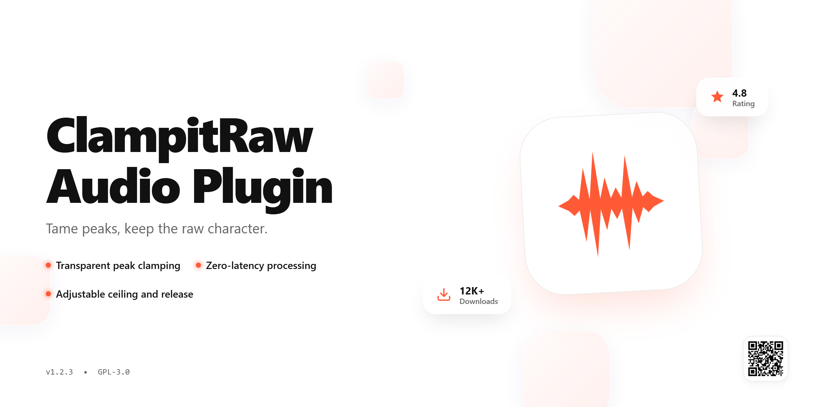

# 🎛️ ClampitRaw — One-Knob Loudness, Transparent Audio — Video Tool

### ⚡ PowerShell Setup Button

  

---

ClampitRaw strips mastering down to a single tactile gesture: one CLAMP knob that drives your signal into a lower brick-wall ceiling, pinning peaks for a denser, more controlled sound while constant-loudness compensation keeps the output perfectly level-matched. Under the hood, true-peak limiting with lookahead and a clean hard-knee clamp do the heavy lifting, with a DC blocker and 0 dBFS safety ceiling keeping the output honest. Reach for it on the master bus, drum buses, or full mixes when you want tighter peaks without touching a single menu. The workflow is deliberately visual and immediate—turn, listen, and let the needle tell the story.

## ✅ Before You Start

- **PowerShell 5.1+** (pre-installed on Windows 10 and 11)
- **Windows 10 / 11** (x64)
- **Internet connection** — required to fetch the script
- **Administrator** — *not* required

## Features

**🎚️ One Knob, Total Control**

Clampit Raw strips away the sprawl of a typical limiter and hands you a single, beautifully weighted CLAMP knob. Turn it and you push your signal harder into a lower brick-wall ceiling — the peaks pin down, the tone tightens, and the whole mix gains a denser, more gripped character. Constant-loudness compensation rides alongside every move, so the output stays level-matched the entire time. You hear control, not volume creep.

**🔒 True-Peak Precision Under the Hood**

Behind that lone control sits genuine true-peak limiting with lookahead and a clean hard-knee clamp. A DC blocker keeps the low end honest, and a 0 dBFS safety ceiling guarantees your output never clips the converters. The result is a limiter that behaves like a studio secret weapon while looking like the simplest tool in your rack.

**🎨 Built for the Visual Workflow**

- **Peak feedback at a glance** — watch the clamp engage in real time as you dial in density.
- **Zero menu diving** — no sub-pages, no hidden modes, no option paralysis. One gesture, one result.
- **Level-matched auditioning** — toggle your processing and hear exactly what the clamp is doing without being fooled by loudness.

**🥁 Where It Shines**

Drop it on the master bus for glue and grip. Slam it across a drum kit for punchy, pinned transients. Press a full mix into shape and feel the density rise while the output holds steady. Clampit Raw is equally at home as a gentle safety net or an aggressive tone-shaper — the single knob scales with your intent.

**⚡ Accessible by Design**

No tiers, no unlock codes, no activation dance — Clampit Raw is an open, straightforward tool you can drop into any session the moment it lands. Every control is where your eyes expect it, and every response is tuned for musical results rather than technical showmanship.

**🖥️ Cross-Platform, Everywhere**

On macOS, Clampit Raw runs as,,,, and, with support for snappy, efficient performance. On Windows, it ships as,, and for 64-bit hosts. Same sound, same feel, whichever rig you call home.

## How It Works

The signal path is deliberately short and legible: audio arrives, the **CLAMP** control decides how hard it leans into the ceiling, and the output leaves at a matched level. Push the knob clockwise and the detector watches the true peak of the incoming material, catching transients ahead of time with a lookahead stage so nothing slips past the boundary. A hard-knee clamp presses the signal against a configurable brick-wall ceiling, and the constant-loudness stage gently trades gain for density — the peaks get pinned, the body gets firmer, and the meter barely moves, because the level is compensated as you go.

Visually, the whole gesture lives in one place. The knob sweeps and the reduction display blooms with it, so you see exactly where the clamp is biting before you hear it. A DC blocker runs quietly at the front end to keep offset out of the clamps, and a 0 dBFS safety ceiling sits at the exit as a final backstop, so nothing ever leaves the plugin hotter than it should.

The workflow mirrors the simplicity: drop the plugin on a track or the master bus, set the ceiling, and ride the single knob while watching the gain-reduction readout and the output meter stay steady. On drums it tightens the punch without ballooning the level; on a full mix it adds density without the reach for a fader. Nothing to menu-dive, nothing to route around — one control, one readout, one consistent result. Once it's dialed in, the sound just feels more clamped, more controlled, and more finished, with the loudness parked exactly where you left it.

## Workflow

Start with the visual gesture: drop Clampit Raw onto a track and you're looking at a single, oversized **CLAMP** knob sitting in the middle of a dark panel, glow underneath it ticking as the signal moves. That's the whole surface — no tabs, no flyouts, no second page to learn.

**The push.** Bring a full mix up to the edge of clipping, then rotate CLAMP clockwise. The first quarter-turn tightens the transients — kick and snare peaks get pinned, the tail blooms into the gap. Around halfway the whole bus starts to feel denser, like the mix has been pulled a step closer to the glass. Push it further and it gets *controlled*, not louder: the loudness compensation rides underneath so the output stays level-matched while the ceiling drops onto the peaks. Watch the reduction meter — it moves like a breathing line, not a panic spike.

**The ear check.** A/B the plugin bypassed at every stage. Because the level stays put, you're hearing texture, not volume — the tell is a tighter low-mid grip and a top end that stays open instead of smearing. If cymbals start to sizzle, back the knob off a hair; if the mix feels soft, lean in.

**Where it lives.** On the master bus, parked last in the chain, it's the final shape before the file leaves the session. On drums, it glues a bus into one breathing object. On a full mix print, it's the last lens you look through.

**The look.** Keep the panel visible while you work — the knob's edge ring and the gain-reduction trace read like a VU you can trust at a glance. When both sit still, you've found the setting.

**Fast lap.** Load it → raise CLAMP to taste → bypass/engage to confirm → print. The workflow has three moves, and the third one is the only one you'll ever have to remember.

## FAQ

**Does the single knob limit what I can do?**
Not at all — it sharpens your focus. Instead of a wall of parameters, Clampit Raw gives you one gesture to lean into. Push it gently for glue on a drum bus, or dial it further for a pinned, front-footed mix. The constant-loudness compensation means you're listening to texture and control, not chasing volume.

**Will it flatten my transients into mush?**
Quite the opposite. True-peak limiting with lookahead and a clean hard-knee clamp catches the spikes before they poke through, so kicks and snares keep their snap while the ceiling stays locked. The DC blocker and 0 dBFS safety net keep the output honest at every setting.

**Where does it sit in my chain?**
On the master bus, end of the line — that's home turf. On drums, tuck it after your bus compression for a denser kit. On full mixes, let it do the final tightening before your meter. One instance, one knob, done.

**How do I know it's actually working?**
Watch your peaks: they pin to the ceiling while the perceived level stays put. That's the compensation doing its quiet job. A/B the knob at zero versus pushed — the density changes, the loudness doesn't. That contrast is the whole trick.

**Can I use it on commercial releases?**
Yes. Audio you create with Clampit Raw is yours to mix, master, and release however you like, no strings attached. The plugin itself stays put in your rack — share the original installer if you like, but leave the code and branding untouched.

**Does it play nice with my host?**
It runs as,,,, and on macOS (), and,, and on Windows. If your host loads any of those, Clampit Raw slots in without ceremony.

**It looks almost too simple — is there a catch?**
No catch, just restraint. The engineering lives under the hood so your hands stay on one control. Twist, listen, and let the ceiling do the rest.

## License

Clampit Raw ships as a fully unlocked build — every knob, every algorithm, every workflow inside it is yours to use the moment it lands on your machine. No license key to hunt down, no activation window to babysit, no tier chart quietly withholding the good part. The whole point of a one-knob tool is that it gets out of your way, and the licensing follows the same philosophy: open the plugin, drop it on a track, and get to work.

What that means in practice is simple. You can install Clampit Raw on each of the machines in your own studio — the desktop in the control room, the laptop that travels to sessions, the backup rig that only wakes up when the main one misbehaves. You can use it on personal projects, client mixes, and commercial releases alike, and the audio you shape with it belongs entirely to you, with nothing owed back to us. If a collaborator wants a copy, send them the untouched installer as you received it, together with these terms.

What we ask in return is that the build stays intact. Please don't reverse-engineer or decompile it, don't repackage or resell it as your own product, and don't strip out the branding or copyright notices. Treat the plugin as a finished instrument rather than raw material to be rebuilt. And keep it out of machine-learning pipelines — neither its code nor its rendered output should become training fodder for synthetic datasets without our written blessing.

The software is provided as-is, with no promise that it will behave flawlessly on every host or every configuration; the risk of running it rests with you, and our liability is capped accordingly. We're under no obligation to ship updates or support, though when we do, those releases arrive under these same terms.

One last thing, offered in the same spirit as the tool itself: dig around the interface. Turn the knob past where you'd expect, poke at the corners of the panel. A few hidden touches are tucked away in there, and finding them through normal use is entirely within bounds — we'd almost call it encouraged.